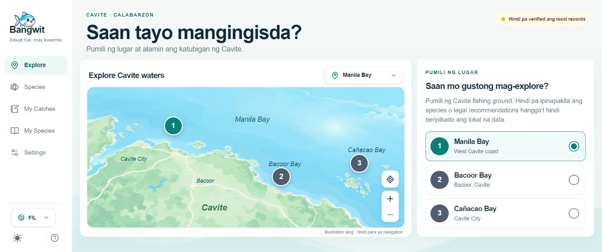

# Joseph T. Lopez — Developer Portfolio

Personal portfolio for selected web and mobile projects, technical skills, education, certificates, and contact details.

**Live portfolio:** [josephlopez.vercel.app](https://josephlopez.vercel.app)  
**Source:** [github.com/JosephLopezzzz/My-Portfolio-Website](https://github.com/JosephLopezzzz/My-Portfolio-Website)

## What’s here

- A responsive, single-page portfolio with a light and dark theme.
- Project summaries that identify role, scope, stack, and available source or preview links.
- A direct project inquiry path, Services and Process sections, plus skills, education, and certificates.
- A Work with me panel with direct email, LinkedIn, and Google Calendar booking.
- Ambient particles, an animated cursor, click sparks, and an animated portrait, with reduced motion preferences respected.
- An optional live estimate of active browser tabs in the footer.

## Selected projects

### Nokma

A solo nutrition and macro-tracking mobile app built with React Native, Expo, TypeScript, and SQLite. The public website is a brand overview; separate links on the portfolio open the source and Expo build.

### HR Management System

A school project: a role-based HR application covering employee records, departments, attendance, leave, performance, payroll, audit logs, and settings. The public repository contains its setup instructions; there is no interactive demo link on the portfolio.

### Fraud Detection in Microfinance

A school project built with React, TypeScript, Express, and Supabase/PostgreSQL. It includes rule-based alerts for transaction patterns such as duplicates, rapid activity, large amounts, and after-hours activity; it is not presented as machine-learning fraud detection.

### Bangwit

Bangwit is a Philippines-focused fishing companion for anglers and local fishers. Explore aquatic species by location, keep a private catch journal, and build a personal species collection. Verified regional species records, fishing rules and seasons, and safety advisories are planned.



### Fleet and Transportation Management System

A team capstone for hotel guest transportation operations. It handles booking requests, approvals, driver and vehicle scheduling, GPS-tracked trips, and odometer, fuel, and maintenance follow-up. The web dashboard uses Next.js and React; its driver app uses Expo and React Native, with PostgreSQL on Supabase. [Source repository](https://github.com/ro-mee/fleet-transpo).

## Stack

- **Frontend:** React 18, TypeScript, Vite 5, Tailwind CSS 3, Radix UI.
- **UI utilities:** React Router, next-themes, Lucide React, React Icons, and Framer Motion.
- **Visitor presence:** Vercel function at `/api/presence` backed by Upstash Redis.

## Run locally

Requirements: Node.js 18 or newer and npm.

```sh
git clone https://github.com/JosephLopezzzz/My-Portfolio-Website.git
cd My-Portfolio-Website
npm ci
```

Start the site:

```sh
npm run dev
```

Vite serves the site at [http://localhost:8080](http://localhost:8080). Use `vercel dev` when running the presence function locally.

## Build and deploy

Create a production frontend build with:

```sh
npm run build
```

The frontend output is written to `dist/`. The public appointment schedule link is in `src/lib/contact.ts`.

Set the server-only `UPSTASH_REDIS_REST_URL` and `UPSTASH_REDIS_REST_TOKEN` in the Vercel project environment to enable the visitor count. For local use with Vercel Dev, set them in `.env.local`. The site sends a random, temporary tab ID while the tab is visible. The API reports only the approximate number of tabs seen in the past 75 seconds, including the current tab. The row is hidden when the service is unavailable.

Environment files, local overrides, and private key files are excluded by `.gitignore`. If a credential is ever committed or exposed, rotate it with its provider; adding it to `.gitignore` does not remove it from Git history.

## Project structure

```text
api/
  presence.ts                Anonymous active-tab count
public/
  certs/                     Certificate PDFs and badge images used by the site
  profile/                   Light and dark profile portraits
  resume.pdf                 Public downloadable resume
src/
  components/
    sections/                Portfolio sections, including services and process
    ui/                      Shared controls and contact panel
  hooks/                     Reusable React hooks
  lib/                       Shared utilities
  pages/                     Portfolio and supporting routes
  App.tsx                    Routes and providers
  main.tsx                   Browser entry point
vite.config.ts               Vite configuration
.github/workflows/ci.yml     Lint, tests, and production build checks
```

## Scripts

| Command | Purpose |
| --- | --- |
| `npm run dev` | Start the local Vite server. |
| `npm run lint` | Run ESLint. |
| `npm test` | Run the Vitest suite. |
| `npm run build` | Build the production frontend into `dist/`. |
| `npm run preview` | Preview a production build locally. |
