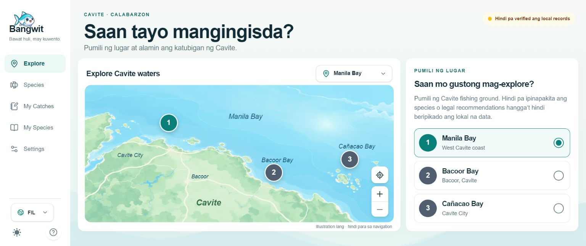

# Joseph T. Lopez — Developer Portfolio

Personal portfolio for selected web and mobile projects, technical skills, education, certificates, and contact details.

**Live portfolio:** [josephlopez.vercel.app](https://josephlopez.vercel.app)  
**Source:** [github.com/JosephLopezzzz/My-Portfolio-Website](https://github.com/JosephLopezzzz/My-Portfolio-Website)

## What’s here

- A responsive, single-page portfolio with a light and dark theme.
- Project summaries that identify role, scope, stack, and available source or preview links.
- A direct project inquiry path, plus skills, education, and certificates.
- An optional streaming Gemini assistant backed by the server-side `/api/chat` route.
- Reduced decorative motion and no client-side Gemini key.

## Selected projects

### Nokma

A solo nutrition and macro-tracking mobile app built with React Native, Expo, TypeScript, and SQLite. The public website is a brand overview; separate links on the portfolio open the source and Expo build.

### HR Management System

A role-based HR application covering employee records, departments, attendance, leave, performance, payroll, audit logs, and settings. The public repository contains its setup instructions; there is no interactive demo link on the portfolio.

### Fraud Detection in Microfinance

A thesis capstone built with React, TypeScript, Express, and Supabase/PostgreSQL. It includes rule-based alerts for transaction patterns such as duplicates, rapid activity, large amounts, and after-hours activity; it is not presented as machine-learning fraud detection.

### Bangwit

A fishing companion prototype with a Cavite waterbody explorer, local catch journal, and personal species list. Catch data is stored in browser IndexedDB. Verified regional species records, fishing rules, and safety guidance are not available yet.



## Stack

- **Frontend:** React 18, TypeScript, Vite 5, Tailwind CSS 3, Radix UI.
- **UI utilities:** React Router, next-themes, Lucide React, React Icons, and Framer Motion.
- **Chat API:** Vercel serverless function at `/api/chat`, using the Google GenAI SDK and a server-only `GEMINI_API_KEY`.

## Run locally

Requirements: Node.js 18 or newer and npm.

```sh
git clone https://github.com/JosephLopezzzz/My-Portfolio-Website.git
cd My-Portfolio-Website
npm ci
```

To enable Gemini chat in local development, copy the example environment file and add a key from your own Google AI project:

**Windows PowerShell**

```powershell
Copy-Item .env.example .env.local
```

**macOS or Linux**

```sh
cp .env.example .env.local
```

Set `GEMINI_API_KEY` in `.env.local`. The key is read by the server-side chat handler; do not rename it to a `VITE_` variable or put it in frontend code. Chat is optional, so the rest of the portfolio runs without it.

### Gemini key security

An earlier version used `VITE_GEMINI_API_KEY` in a browser build. Treat any key previously used with that name as compromised and revoke or rotate it if you have not already. The current route reads `GEMINI_API_KEY` on the server only. Vite exposes `VITE_` variables to client-side code, so do not put secrets in that namespace.

Start the site:

```sh
npm run dev
```

Vite serves the site at [http://localhost:8080](http://localhost:8080) and provides a local `/api/chat` middleware for development.

## Build and deploy

Create a production frontend build with:

```sh
npm run build
```

The frontend output is written to `dist/`. The repository includes `api/chat.ts` for Vercel’s serverless `/api/chat` route. On Vercel, configure `GEMINI_API_KEY` in the project’s environment settings if chat should be enabled, then deploy. A static-only host can serve the site but needs its own server-side `/api/chat` implementation for Gemini responses.

Environment files, local overrides, and private key files are excluded by `.gitignore`. If a credential is ever committed or exposed, rotate it with its provider; adding it to `.gitignore` does not remove it from Git history.

## Project structure

```text
api/
  chat.ts                    Server-side Gemini chat handler
public/
  certs/                     Certificate PDFs and badge images used by the site
  profile/                   Light and dark profile portraits
  resume.pdf                 Public downloadable resume
src/
  components/
    sections/                Portfolio sections, including services and process
    ui/                      Shared controls and chat interface
  hooks/                     Reusable React hooks
  lib/                       Shared utilities
  pages/                     Portfolio and supporting routes
  App.tsx                    Routes and providers
  main.tsx                   Browser entry point
vite.config.ts               Vite configuration and local chat middleware
.github/workflows/ci.yml     Lint, tests, and production build checks
```

## Scripts

| Command | Purpose |
| --- | --- |
| `npm run dev` | Start the local Vite server. |
| `npm run lint` | Run ESLint. |
| `npm test` | Run the Vitest suite. |
| `npm run build` | Build the production frontend into `dist/`. |
| `npm run preview` | Preview a production build locally. |
